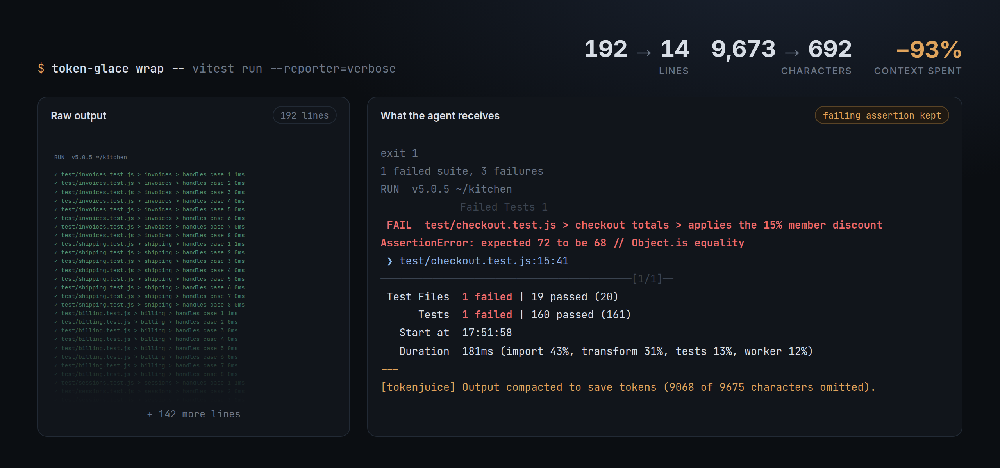

<p align="center">
  
</p>

<h1 align="center">Token Glace</h1>

<p align="center">
  <strong>Noisy tools burn context. Glace hands the agent the reduction.</strong><br>
  Deterministic output compaction for terminal-heavy agent workflows.
</p>

<p align="center">
  <a href="https://brigade.tools/token-glace">Website</a> &middot;
  <a href="#quick-start">Quick start</a> &middot;
  <a href="docs/integrations.md">Integrations</a> &middot;
  <a href="docs/README.md">Docs</a>
</p>

<p align="center">
  
  
  
  
</p>

<p align="center">
  
</p>

<p align="center"><sub>Real output from a 20-file demo suite with one failing test. Only the project path is shortened.</sub></p>

The command runs untouched. Token Glace classifies what it was, applies inspectable JSON rules, and returns a smaller payload that keeps the lines that matter: failures, locations, and the summary. The full output stays one flag away.

## Quick start

```bash
brigade add tokens                        # install via Brigade

token-glace wrap -- pnpm test             # run a command, get the compacted result
token-glace wrap --raw -- pnpm test       # same command, full output
token-glace install claude-code           # wire it into a client
```

The catalog has 117 entries across CLI harnesses, editors, desktop clients, and frameworks. Claude Code, Codex CLI, Cursor, GitHub Copilot CLI, OpenClaw, OpenCode, and pi get first-class wiring. The rest use guidance files, plugins, or explicit wrapping. See the [integration catalog](docs/integrations.md#harness-and-framework-catalog) for each setup command.

### Install from source

Requires Node `>=22.12.0` and pnpm 10.34.9 via Corepack.

```bash
git clone https://github.com/escoffier-labs/token-glace.git
cd token-glace
pnpm install && pnpm build
pnpm link --global          # puts token-glace on PATH
token-glace --version
```

The `tokenjuice` npm package and the `vincentkoc/tap` Homebrew formula install the upstream build. Use the source install above for this fork.

## How it works

| Surface | Use |
| --- | --- |
| `wrap` | Runs a command and compacts the observed output |
| `reduce` | Compacts text that already exists (file or stdin) |
| `reduce-json` | Stable JSON protocol for host adapters ([spec](docs/spec.md)) |

Reduction is rule-driven. Built-in rules live in `src/rules`, user overrides in `~/.config/tokenjuice/rules`, and project overrides in `.tokenjuice/rules`. Later layers override earlier ones by rule id. Rules classify the command, normalize lines, keep or drop patterns, count facts, and retain head/tail slices. See [rules](docs/rules.md).

Host adapters stay thin: they install a hook, extension, rule, or guidance file and call the same shared reducer. Exact file reads stay raw, and unsafe mixed command sequences stay raw.

<details>
<summary><strong>All commands</strong></summary>

Run `token-glace --help` for flags and details.

```bash
token-glace --help
token-glace --version
token-glace reduce [file]
token-glace reduce-json [file]
token-glace wrap -- <command> [args...]
token-glace wrap --raw -- <command> [args...]     # also --full
token-glace wrap --store -- <command> [args...]   # keep raw output as an artifact
token-glace install <client> [--local]
token-glace uninstall <client>
token-glace ls
token-glace cat <artifact-id>
token-glace verify [--fixtures]
token-glace discover
token-glace doctor [hooks | <client>]
token-glace stats [--timezone utc]
```

</details>

## Why not something else?

- **A bigger output limit** moves the cost. The context still fills with `pnpm test` noise and `docker build` layer spam, and every token is paid for on every turn.
- **An LLM summarizer** costs another model call, is non-deterministic, and can drop the one error line you needed. The same input to Token Glace always produces the same output, and nothing is invented.
- **`head` / `tail`** keeps the wrong lines and drops the failing assertion in the middle. Token Glace classifies the command first.
- **Per-tool wrappers** scatter brittle parsing across every integration. One shared reducer means a fix lands once.

## What it is not

Token Glace is an output compactor, not a shell, a sandbox, or a security tool. It does not rewrite the command you run, restrict what commands can do, redact secrets, discard raw bytes, or summarize with a model.

## About this fork

Token Glace is a fork of [vincentkoc/tokenjuice](https://github.com/vincentkoc/tokenjuice) (MIT), which owns the reducer engine, the host integration matrix, and the CLI surface. This fork:

- publishes `token-glace` as the primary command and keeps `tokenjuice` as a legacy alias
- tracks the build the Escoffier Labs agent fleet runs
- uses a neutral, non-instructional compaction footer and host guidance
- ships a non-mutating Claude Code `PostToolUse` adapter with a 16384-character size gate, with [PreToolUse wrapping opt-in](docs/claude-code-integration.md)
- keeps Vincent Koc's copyright and the full MIT notice in [LICENSE](LICENSE)

Contributions are welcome here. Improvements that are not fork-specific can also go upstream. See [CONTRIBUTING.md](CONTRIBUTING.md) and [SECURITY.md](SECURITY.md).

Built on the work of [Vincent Koc](https://github.com/vincentkoc).
