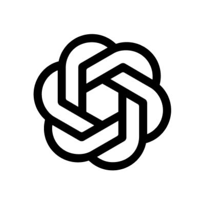
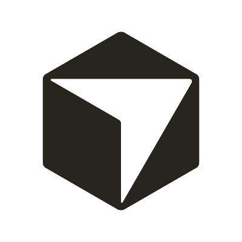
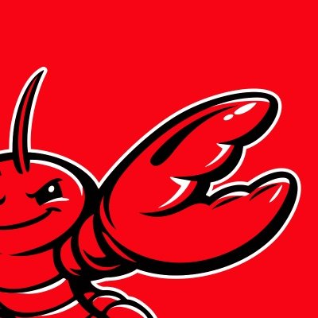
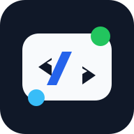
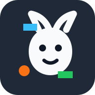
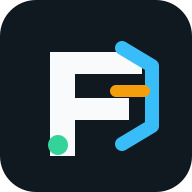
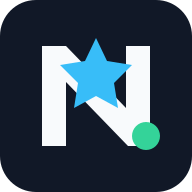
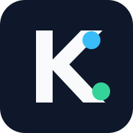

# integration catalog

Choose a client below, then read its guide in the [documentation index](README.md).
The tables list setup routes. They do not imply equal support or native acceptance.
See [adapter support and verification](adapter-support-matrix.md) for recorded test evidence and remaining acceptance work.

Guidance files ask an agent to call `tokenjuice wrap`. They do not compact every command automatically.
Some observation-only hooks are retired because additive context retains the original output.

## native and external integration routes

| Logo | Client | Install | Configuration / behavior |
| --- | --- | --- | --- |
|  | [Claude Code](https://docs.anthropic.com/en/claude-code) | `tokenjuice install claude-code` | `~/.claude/settings.json` |
|  | [CodeBuddy](https://codebuddy.tencent.com/) | `tokenjuice install codebuddy` | `~/.codebuddy/settings.json` |
|  | [Codex CLI](codex-integration.md) | `tokenjuice wrap -- <command>` | Native 0.166.0 hooks lack exit status; automatic compaction stays off |
|  | [Cursor](https://cursor.com/hooks) | `tokenjuice install cursor` | `~/.cursor/hooks.json` |
|  | [Droid (Factory CLI)](droid-integration.md) | `tokenjuice install droid` | `~/.factory/hooks.json` or legacy settings |
|  | [GitHub Copilot CLI](https://github.com/github/copilot-cli) | `tokenjuice install copilot-cli` | native Bash replacement; [1.0.105 acceptance](copilot-cli-integration.md) |
|  | [OpenClaw](https://openclaw.ai/) | `openclaw plugins install @openclaw/tokenjuice` | `~/.openclaw/openclaw.json` |
|  | [OpenCode](https://opencode.ai/) | `tokenjuice install opencode` | `~/.config/opencode/plugins/tokenjuice.js` |
|  | [pi](https://github.com/badlogic/pi-mono/tree/main/packages/coding-agent) | `tokenjuice install pi` | `~/.pi/agent/extensions/tokenjuice.js` |
|  | [VS Code Copilot Chat (Local)](vscode-copilot-integration.md) | `tokenjuice install vscode-copilot` | `~/.copilot/hooks/tokenjuice-vscode.json` |

## beta and guidance routes

| Logo | Client | Install | Configuration / behavior |
| --- | --- | --- | --- |
|  | [AdaL CLI](https://docs.sylph.ai/features/plugins-and-skills) | `tokenjuice install adal` | `AGENTS.md` |
|  | [Aether](https://aether-agent.io/) | `tokenjuice install aether` | `.aether/tokenjuice.md` / `.aether/settings.json` |
|  | [aictl](https://www.aictl.app/) | `tokenjuice install aictl` | `AICTL.md` |
|  | [AI Memory Protocol](https://github.com/bburda/ai_memory_protocol) | `tokenjuice install ai-memory-protocol` | `.memories/memory/preferences.rst` |
|  | [Aider](https://aider.chat/) | `tokenjuice install aider` | `CONVENTIONS.tokenjuice.md` |
|  | [Agent Layer](https://agent-layer.dev/) | `tokenjuice install agent-layer` | `.agent-layer/instructions/tokenjuice.md`; run `al sync` after install or uninstall |
|  | [AgentInit](https://pypi.org/project/agentinit/) | `tokenjuice install agentinit` | `AGENTS.md`; run `agentinit sync` after install or uninstall |
|  | [Agentlink](https://agentlink.run/) | `tokenjuice install agentlink` | `AGENTS.md`; run `agentlink sync` after install or uninstall |
|  | [Agentloom](https://agentloom.sh/docs) | `tokenjuice install agentloom` | `.agents/rules/tokenjuice-agentloom.md`; run `agentloom sync` after install or uninstall |
|  | [agents-cli](https://agents-cli.sh/) | `tokenjuice install agents-cli` | `~/.agents/memory/AGENTS.md`; run `agents sync` after install or uninstall |
|  | [AGENTS.md](https://agents.md/) | `tokenjuice install agents-md` | `AGENTS.md` |
|  | [agents.ge](https://agents.ge/) | `tokenjuice install agentsge` | `.agents/rules/tokenjuice-agentsge.md` |
|  | [AgentsMesh](https://samplexbro.github.io/agentsmesh/) | `tokenjuice install agentsmesh` | `.agentsmesh/rules/tokenjuice.md`; run `agentsmesh generate` after install or uninstall |
|  | [Amazon Q Developer CLI / Kiro compatibility](https://kiro.dev/cli/migrating-from-q/) | `tokenjuice install amazon-q` | `.amazonq/rules/tokenjuice.md` |
|  | [Amp](https://ampcode.com/manual) | `tokenjuice install amp` | `AGENTS.md` / `AGENT.md` / `CLAUDE.md` |
|  | [Google Antigravity](https://antigravity.google/) | `tokenjuice install antigravity` | `.agents/rules/tokenjuice.md` |
|  | [anywhere-agents](https://anywhere-agents.readthedocs.io/) | `tokenjuice install anywhere-agents` | `AGENTS.local.md`; run `anywhere-agents` after install or uninstall |
|  | [Augment](https://docs.augmentcode.com/cli/rules) | `tokenjuice install augment` | `.augment/rules/tokenjuice.md` |
|  | [Avante.nvim](https://github.com/yetone/avante.nvim) | `tokenjuice install avante` | `avante.md` |
|  | [Baz](https://docs.baz.co/agents/skills-and-instructions) | `tokenjuice install baz` | `.baz/skills/tokenjuice/SKILL.md` |
|  | [Bito](https://docs.bito.ai/ai-code-reviews-in-git/agent-settings/repo-level-settings) | `tokenjuice install bito` | `.bito.yaml` / `.bito/tokenjuice.md` |
|  | [Blackbox CLI](https://docs.blackbox.ai/features/blackbox-cli/skills) | `tokenjuice install blackbox` | `.blackbox/skills/tokenjuice/SKILL.md` |
|  | [Blocks](https://docs.blocks.team/using-blocks/features/skills) | `tokenjuice install blocks` | `.agents/skills/tokenjuice-blocks/SKILL.md` |
|  | [Clawdbot](https://docs.clawd.bot/skills) | `tokenjuice install clawdbot` | `skills/tokenjuice/SKILL.md` |
|  | [IBM Bob Shell](https://bob.ibm.com/shell/configuration/configuring) | `tokenjuice install bob` | `AGENTS.md` |
|  | [Builder](https://www.builder.io/c/projects-configuration-files) | `tokenjuice install builder` | `.builder/rules/tokenjuice.mdc` |
|  | [Charlie](https://docs.charlielabs.ai/customization/instructions) | `tokenjuice install charlie` | `AGENTS.md` |
|  | [Cline](cline-integration.md) | `tokenjuice install cline` | `~/.cline/hooks/PreToolUse`; native CLI 3.0.74 input wrapping |
|  | [CodeAnt](https://docs.codeant.ai/ide/review/code_review_instructions) | `tokenjuice install codeant` | `.codeant/instructions.json` |
|  | [Codebuff](https://www.codebuff.com/help/quick-start) | `tokenjuice install codebuff` | `AGENTS.md` |
|  | [Codegen](https://docs.codegen.com/settings/repo-rules) | `tokenjuice install codegen` | `AGENTS.md` |
|  | [Coder Agents](https://coder.com/ai-coder/agents) | `tokenjuice install coder-agents` | `.agents/skills/tokenjuice/SKILL.md` |
|  | [CodeRabbit](https://docs.coderabbit.ai/configuration/path-instructions) | `tokenjuice install coderabbit` | `.coderabbit.yaml` |
|  | [Command Code](command-code-integration.md) | `tokenjuice wrap -- <command>` | Additive hook retired; scoped legacy cleanup remains available |
|  | [Continue](https://docs.continue.dev/) | `tokenjuice install continue` | `.continue/rules/tokenjuice.md` |
|  | [Crush](https://github.com/charmbracelet/crush) | `tokenjuice install crush` | `.crush/skills/tokenjuice/SKILL.md` |
|  | [Deep Agents Code](https://docs.langchain.com/oss/javascript/deepagents/code/overview) | `tokenjuice install deepagents` | `.deepagents/AGENTS.md` |
|  | [Devin for Terminal](https://cli.devin.ai/extensibility/hooks/overview) | `tokenjuice install devin` | `.devin/hooks.v1.json` |
|  | [dot-agents](https://www.dot-agents.com/) | `tokenjuice install dot-agents` | `~/.agents/rules/global/rules.mdc`; run `dot-agents sync` after install or uninstall |
|  | [Docker Agent](https://docs.docker.com/ai/docker-agent/) | `tokenjuice install docker-agent` | `.docker-agent/tokenjuice.md` |
|  | [ECA](https://eca.dev/) | `tokenjuice install eca` | `.eca/skills/tokenjuice/SKILL.md` |
|  | [Elyra](https://elyracode.com/) | `tokenjuice install elyra` | `.elyra/skills/tokenjuice/SKILL.md` |
|  | [Firebase Studio](https://firebase.google.com/studio/set-up-gemini) | `tokenjuice install firebase-studio` | `.idx/airules.md` |
|  | [ForgeCode](https://forgecode.dev/custom-rules/) | `tokenjuice install forgecode` | `AGENTS.md` |
|  | [Gemini CLI](https://github.com/google-gemini/gemini-cli) | `tokenjuice install gemini-cli` | `~/.gemini/settings.json` |
|  | [GitLab Duo Agent Platform](https://docs.gitlab.com/user/duo_agent_platform/customize/custom_rules/) | `tokenjuice install gitlab-duo` | `.gitlab/duo/chat-rules.md` |
|  | [Goose](https://goose-docs.ai/) | `tokenjuice install goose` | `.goosehints` |
|  | [Greptile](https://www.greptile.com/code-review/greptile-config) | `tokenjuice install greptile` | `.greptile/rules.md` |
|  | [Grok Build](https://docs.x.ai/build/overview) | `tokenjuice install grok-build` | `AGENTS.md` |
|  | Grok Bot | `tokenjuice install grok-bot` | experimental local rule; [cloud skill workflow](grok-bot-integration.md) |
|  | [Community Grok CLI](https://github.com/superagent-ai/grok-cli) | `tokenjuice wrap -- <command>` | [Automatic hook retired](grok-cli-integration.md) |
|  | [gptme](https://gptme.org/prompts.html) | `tokenjuice install gptme` | `AGENTS.md` |
|  | [GitHub Copilot coding agent](https://docs.github.com/en/copilot/using-github-copilot/coding-agent) | `tokenjuice install copilot-agent` | `.github/hooks/tokenjuice-agent.json` |
|  | [Jean2](https://jean2.ai/deep-dive/agents-md) | `tokenjuice install jean2` | `AGENTS.md` |
|  | [JetBrains AI Assistant](https://www.jetbrains.com/help/ai-assistant/) | `tokenjuice install jetbrains-ai` | `.aiassistant/rules/tokenjuice.md` |
|  | [Junie](https://junie.jetbrains.com/junie-cli-usage.html) | `tokenjuice install junie` | `.junie/AGENTS.md` |
|  | [Jules](https://jules.google/) | `tokenjuice install jules` | `AGENTS.md` |
|  | [LeanCTL](https://leanctl.com/configuration) | `tokenjuice install leanctl` | `.leanctl/instructions.md` |
|  | [Kimi Code CLI](https://www.kimi.com/code/en/kimi-code-cli/guides/getting-started.html) | `tokenjuice wrap -- <command>` | [Automatic hook retired](kimi-integration.md) |
|  | [Kiro](https://kiro.dev/) | `tokenjuice install kiro` | `.kiro/steering/tokenjuice.md` |
|  | [Kilo Code](https://kilocode.ai/) | `tokenjuice install kilo` | `kilo.jsonc` or `.kilo/kilo.jsonc` + `.kilo/rules/tokenjuice.md` |
|  | [LocalCode](https://www.localcode.codes/) | `tokenjuice install localcode` | `~/.localcode/plugins/tokenjuice/` |
|  | [mcp-agent](https://docs.mcp-agent.com/) | `tokenjuice install mcp-agent` | `.mcp-agent/agents/tokenjuice.md` |
|  | [mini-SWE-agent](https://mini-swe-agent.com/) | `tokenjuice install mini-swe-agent` | `.mini-swe-agent/tokenjuice.yaml` |
|  | [SWE-agent](https://swe-agent.com/latest/) | `tokenjuice install swe-agent` | `.swe-agent/tokenjuice.yaml` |
|  | [Stagewise](https://docs.stagewise.io/agent/skills-and-context) | `tokenjuice install stagewise` | `.stagewise/skills/tokenjuice/SKILL.md` |
|  | [Mistral Vibe](https://docs.mistral.ai/mistral-vibe/agents-skills) | `tokenjuice install mistral-vibe` | `AGENTS.md` |
|  | [Mux / Xum](https://github.com/coder/xum) | `tokenjuice wrap -- <command>` | [Automatic hook retired](mux-integration.md) |
|  | [NovaKit CLI](https://www.novakit.ai/cli) | `tokenjuice install novakit` | `NOVAKIT.md` |
|  | [Knowns](https://knowns.sh/) | `tokenjuice install knowns` | `KNOWNS.md` |
|  | [Ona Agent](https://ona.com/ona/agents/overview) | `tokenjuice install ona` | `.ona/skills/tokenjuice/SKILL.md` |
|  | [OpenHands](https://docs.openhands.dev/) | `tokenjuice wrap -- <command>` | Manual wrapping; [legacy hook cleanup](openhands-integration.md) |
|  | [Open Interpreter](https://www.openinterpreter.com/terminal/agents_md) | `tokenjuice install open-interpreter` | `AGENTS.md` |
|  | [Open WebUI](https://openwebui.com/) | `tokenjuice install openwebui` | `.openwebui/tools/tokenjuice_compact.py` |
|  | [pi-go](https://pi-go.sh/) | `tokenjuice install pi-go` | `.pi/skills/tokenjuice/SKILL.md` |
|  | [Plandex](https://docs.plandex.ai/) | `tokenjuice install plandex` | `PLANDEX.tokenjuice.md` |
|  | [Qodo Code Review](https://docs.qodo.ai/code-review/get-started/configuration-overview/configuration-file) | `tokenjuice install qodo` | `.pr_agent.toml` |
| | [OpenCode V2](opencode-v2-integration.md) | `tokenjuice install opencode-v2` | foreground `shell` result replacement; native v2.0.18 acceptance |
| | [Antigma Ante](ante-integration.md) | `tokenjuice install ante` | project `AGENTS.md` or `CLAUDE.md` |
|  | [Qoder CLI](https://docs.qoder.com/cli/using-cli) | `tokenjuice install qoder-cli` | native `PostToolUse`; `qoder` retains `AGENTS.md` guidance |
| QoderWork | [QoderWork skills](qoderwork-integration.md) | `tokenjuice install qoderwork` | guidance skill at `~/.qoderwork/skills/tokenjuice/SKILL.md` |
| QwenWork | [QwenWork](https://www.alibabacloud.com/help/zh/qwenwork/skills) | `tokenjuice install qwenwork` | guidance skill at `~/.qwenwork/skills/tokenjuice/SKILL.md` |
|  | [Qwen Code](https://qwenlm.github.io/qwen-code-) | `tokenjuice install qwen-code` | `.qwen/settings.json` |
|  | [Replit Agent](https://docs.replit.com/references/project-setup/replit-dot-md) | `tokenjuice install replit` | `replit.md` |
|  | [Roo Code](https://roocode.com/) | `tokenjuice install roo` | `.roo/rules/tokenjuice.md` |
|  | [Rovo Dev CLI](https://support.atlassian.com/rovo/use-memory-in-rovo-dev-cli/) | `tokenjuice install rovo` | `AGENTS.md` |
|  | [Ruler](https://github.com/intellectronica/ruler) | `tokenjuice install ruler` | `.ruler/tokenjuice.md` |
|  | [Tabby](https://tabby.tabbyml.com/) | `tokenjuice install tabby` | `~/.tabby/config.toml` |
|  | [Tabnine CLI](https://docs.tabnine.com/main/getting-started/tabnine-cli/features/cli-commands) | `tokenjuice install tabnine` | `TABNINE.md` |
|  | [Trae](https://traeide.com/) | `tokenjuice install trae` | `.trae/rules/project_rules.md` |
|  | [UiPath for Coding Agents](https://www.uipath.com/developers/coding-agents) | `tokenjuice install uipath` | `AGENTS.md` |
|  | [Warp](https://docs.warp.dev/agent-platform/capabilities/rules) | `tokenjuice install warp` | `AGENTS.md` / `WARP.md` |
|  | [Windsurf](https://windsurf.com/) | `tokenjuice install windsurf` | `.windsurf/rules/tokenjuice.md` |
|  | [Zed](https://zed.dev/ai/rules.html) | `tokenjuice install zed` | `.rules` |
|  | [Zencoder](https://docs.zencoder.ai/rules-context/zen-rules) | `tokenjuice install zencoder` | `.zencoder/rules/tokenjuice.md` |
